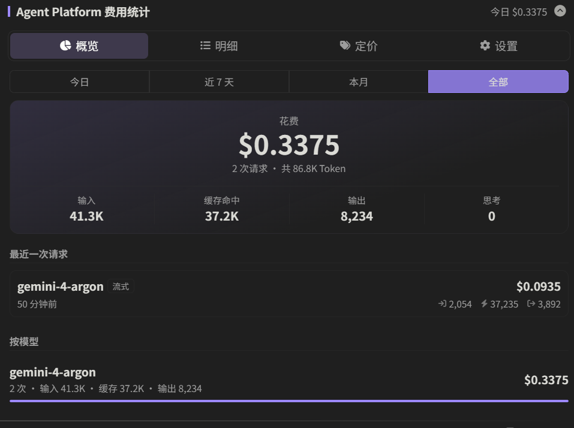

# Agent Platform 费用统计 (ST-GCP-Billing)

SillyTavern 扩展与服务端插件。实时记录 Google Cloud Agent Platform（原 Vertex AI）每次调用的官方精确 Token 用量并计算花费，支持按时间段与模型汇总、明细查询、自定义模型定价、汇率折算与请求后花费提示。



## 组成

同一个仓库同时是前端扩展和服务端插件，两部分都需要安装：

| 部分 | 入口 | 作用 |
| --- | --- | --- |
| 前端扩展 | `manifest.json` → `extension/` | 汇总面板、明细、定价表、清零、每次请求后的花费提示 |
| 服务端插件 | `package.json` → `server/index.mjs` | 截获 Agent Platform 原始响应，记账、算价、提供接口 |

安装位置都在酒馆的第三方目录里，不修改酒馆本身的文件，不影响酒馆 `git pull`。

## 安装

### 1. 前端扩展

酒馆 → 扩展 → 安装扩展，填入：

```
https://github.com/vvb7456/ST-GCP-Billing
```

### 2. 服务端插件

酒馆的扩展安装界面只能安装前端扩展，服务端插件需要在服务器上操作一次。任选一种：

**方式 A：用酒馆自带的插件安装命令（推荐，可自动更新）**

```bash
cd SillyTavern
node plugins.js install https://github.com/vvb7456/ST-GCP-Billing
```

`config.yaml` 中 `enableServerPluginsAutoUpdate: true`（默认）时，酒馆每次启动都会自动拉取插件更新。

**方式 B：下载 Release 压缩包**

从 [Releases](https://github.com/vvb7456/ST-GCP-Billing/releases) 下载 `agent-platform-billing-server-*.zip`，解压到 `SillyTavern/plugins/` 下，得到 `plugins/agent-platform-billing/`。

### 3. 启用服务端插件并重启

在 `SillyTavern/config.yaml` 中设置：

```yaml
enableServerPlugins: true
```

重启酒馆。启动日志出现 `[agent-platform-billing] hooks installed` 即表示加载成功，扩展面板"设置"页会显示"已连接"。

账本和定价保存在插件目录的 `server/data/`（方式 A）或 `data/`（方式 B）下，更新插件不会覆盖。

## 原理

酒馆后端用 node-fetch 请求 Vertex。非流式时，后端只把文本转发给浏览器，`usageMetadata` 被丢弃，前端无法拿到。
服务端插件在启动时给 node-fetch 的 `Response` 原型加了只读旁路：

- 非流式：`response.text()/json()` 读完后，如果地址是 Vertex `:generateContent`，解析出 `usageMetadata` 记账；
- 流式：酒馆读取 `response.body` 时，如果地址是 Vertex `:streamGenerateContent`，在同一个流上额外监听数据，取最后一个 `usageMetadata`。

返回给酒馆的数据原样不变。图片描述等其它走 Vertex `generateContent` 的调用同样会被记录。

## 计费规则

- 缓存部分（`cachedContentTokenCount`）按缓存价，其余输入按输入价；`toolUsePromptTokenCount` 按输入价；
- 思考 Token（`thoughtsTokenCount`）按输出价；
- 提示词超过"长上下文阈值"时，整次请求的输入/输出/缓存都改用"长·"价格；
- 区域端点（非 global）使用 `nonGlobal` 价格；
- 只按官方标准价计费，限时优惠（赠金返还）不计入；
- 按 `promptTokensDetails` 等的模态区分音频输入、图片输出价格（未填写则按普通价）。

## 许可证

[AGPLv3](./LICENSE)

## 仓库

[github.com/vvb7456/ST-GCP-Billing](https://github.com/vvb7456/ST-GCP-Billing)

