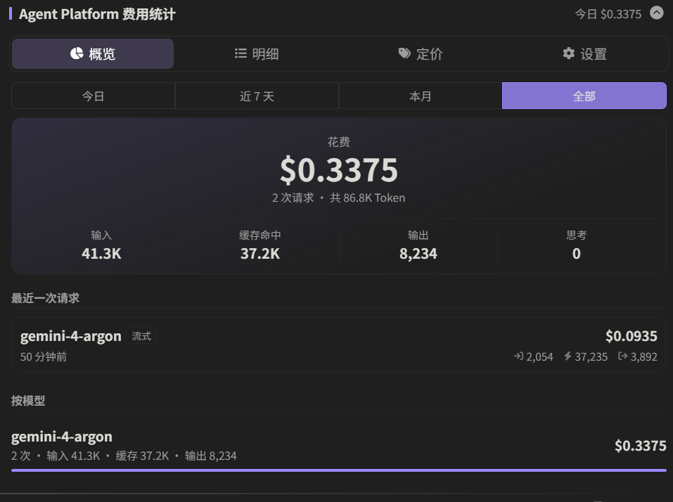

# Agent Platform 助手 (ST-GCP-Billing)

SillyTavern（以及 [TauriTavern](https://github.com/Darkatse/TauriTavern)）的 Google Cloud Agent Platform（原 Vertex AI）增强扩展与服务端插件。提供实时精确 Token 用量与费用统计、自定义模型定价、汇率折算与请求后花费提示；在原版 SillyTavern 下还可自动补齐 Gemini 4 模型列表、启用思考开关与思考强度、并修复非 global 及 `us`/`eu` 多区域端点拼接问题。



## 组成

同一个仓库同时包含前端扩展与服务端插件：

- **原版 SillyTavern**：前端扩展与服务端插件都需要安装；
- **TauriTavern**：**只需安装前端扩展即可开箱即用**，无需服务端插件。

| 部分 | 入口 | 作用 |
| --- | --- | --- |
| 前端扩展 | `manifest.json` → `extension/` | 汇总面板、明细、定价表、清零、每次请求后的花费提示；在 TauriTavern 下自动启用本地直连记账 |
| 服务端插件 | `package.json` → `server/index.mjs` | 原版 SillyTavern 专用：截获 Agent Platform 原始响应，记账、算价、提供接口 |

安装位置都在酒馆的第三方目录里，不修改酒馆本身的文件，不影响酒馆 `git pull`。

## 安装

### TauriTavern（仅需安装前端扩展）

在 TauriTavern → 扩展 → 安装扩展，填入仓库地址即可，无需安装服务端插件：

```
https://github.com/vvb7456/ST-GCP-Billing
```

安装启用后，扩展面板“设置”页会显示“运行模式：TauriTavern”，账本与自定义定价自动持久化在 TauriTavern 本地扩展存储中。

### 原版 SillyTavern

#### 1. 前端扩展

酒馆 → 扩展 → 安装扩展，填入：

```
https://github.com/vvb7456/ST-GCP-Billing
```

#### 2. 服务端插件

酒馆的扩展安装界面只能安装前端扩展，服务端插件需要在服务器上操作一次。任选一种：

**方式 A：用酒馆自带的插件安装命令（推荐，可自动更新）**

```bash
cd SillyTavern
node plugins.js install https://github.com/vvb7456/ST-GCP-Billing
```

`config.yaml` 中 `enableServerPluginsAutoUpdate: true`（默认）时，酒馆每次启动都会自动拉取插件更新。

**方式 B：下载 Release 压缩包**

从 [Releases](https://github.com/vvb7456/ST-GCP-Billing/releases) 下载 `agent-platform-billing-server-*.zip`，解压到 `SillyTavern/plugins/` 下，得到 `plugins/agent-platform-billing/`。

#### 3. 启用服务端插件并重启

在 `SillyTavern/config.yaml` 中设置：

```yaml
enableServerPlugins: true
```

重启酒馆。启动日志出现 `[agent-platform-billing] hooks installed` 即表示加载成功，扩展面板"设置"页会显示"已连接"。

账本和定价按酒馆用户目录保存在 `SillyTavern/data/<用户名>/agent-platform-billing/`（单用户模式下为 `data/default-user/agent-platform-billing/`），支持多用户隔离，更新或重装插件不会覆盖；从旧版本升级时，原 `server/data/` 下的账本和定价会自动迁移到 `default-user` 目录，不影响现有数据。

## 原理

- **原版 SillyTavern**：酒馆后端用 node-fetch 请求 Vertex。非流式时，后端只把文本转发给浏览器，`usageMetadata` 被丢弃，前端无法拿到。服务端插件在启动时给 node-fetch 的 `Response` 原型加了只读旁路：
  - 非流式：`response.text()/json()` 读完后，如果地址是 Vertex `:generateContent`，解析出 `usageMetadata` 记账；
  - 流式：酒馆读取 `response.body` 时，如果地址是 Vertex `:streamGenerateContent`，在同一个流上额外监听数据，取最后一个 `usageMetadata`。
  返回给酒馆的数据原样不变。图片描述等其它走 Vertex `generateContent` 的调用同样会被记录。
- **原版 SillyTavern 额外兼容（可在“设置”页开关，默认开启）**：
  - 自动在 Vertex AI 模型下拉框中补齐缺失的 Gemini 4 与 Gemini 3.8 模型（`gemini-4-neon` / `gemini-4-hydrogen` / `gemini-4-carbon` / `gemini-4-argon` / `gemini-3.8-flash`），并与第三方自定义模型扩展自动去重、互不冲突；
  - 自动为 Gemini 4 请求补全 `thinkingConfig`（同步“显示思考”开关与思考强度映射到 `low`/`medium`/`high`/`xhigh`，未来酒馆上游原生支持时自动让路）；
  - 自动修复原版酒馆拼接 Vertex AI 非 `global` 区域端点、Express 无项目号/带项目号端点以及 `us` / `eu` 多区域端点（`aiplatform.{us|eu}.rep.googleapis.com`）时的域名错误，并在区域下拉建议中补充 `us` 和 `eu`。
- **TauriTavern**：扩展自动订阅 TauriTavern 内置的底层 LLM 请求日志（`llmApiLogs`）并将账本和定价写入原生 `extension.store`：
  - 流式请求直接解析原始 SSE 响应块中的完整 `usageMetadata`（含缓存、思考、模态、联网搜索与中途停止）；
  - 非流式请求从 TauriTavern 归一化后的 `usage` 还原输入、缓存命中、正文输出与思考 Token 用量（推荐开启流式以获取最完整的原始字段）。

## 计费规则与动态清单

- **动态同步模型与价格**：插件不再硬编码模型列表与价格表，启动时及每 12 小时自动从 [models.dev](https://models.dev/) 拉取最新的 `google-vertex` 模型清单与定价并缓存到本地（也可在定价页点击“同步最新清单”手动触发）；
  - 从旧版本升级时会一次性平滑迁移至 `models.dev` 清单（自动保留用户自行添加的非默认模型）；
  - 后续同步时，新增模型自动入表，未手动修改过的默认模型随远端自动更新，用户自行修改或删除的模型永久保留不被覆盖；
  - 对 Gemini 3 及以上正式版自动按谷歌官方规则推算非 `global` 区域端点 +10% 区域价；
- 缓存部分（`cachedContentTokenCount`）按缓存价，其余输入按输入价；`toolUsePromptTokenCount` 按输入价；
- 思考 Token（`thoughtsTokenCount`）按输出价；
- 提示词超过"长上下文阈值"时，整次请求的输入/输出/缓存都改用"长·"价格；
- 区域端点（非 global）使用 `nonGlobal` 价格；
- 按 `promptTokensDetails` 等的模态区分音频输入、图片输出价格（未填写则按普通价）。

## 许可证

[AGPLv3](./LICENSE)

## 仓库

[github.com/vvb7456/ST-GCP-Billing](https://github.com/vvb7456/ST-GCP-Billing)

